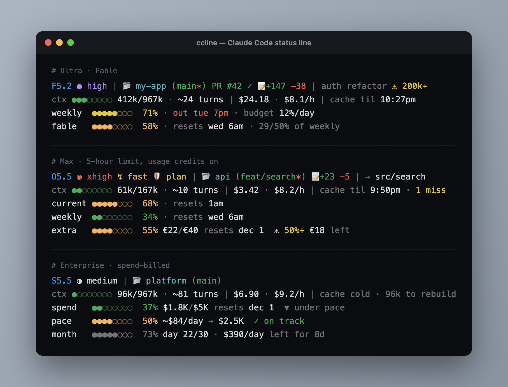

# ccline

A feature-rich statusline for [Claude Code](https://docs.anthropic.com/en/docs/claude-code) that helps you track session health, manage quota, and avoid burning through your Max plan.



## What you get

**Line 1 — Identity & Project**
```
O4.7 1M ◉ xhigh 🛡 plan | 📂 really-app (main*) 📝+147 -38 | @code-reviewer | ⎇ feat-x | → src/features/search
```
- Compact model name with effort level — the full ladder is rendered distinctly:

  | effort | glyph | color   | notes                                      |
  |--------|-------|---------|--------------------------------------------|
  | low    | `◔`   | dim     | minimal reasoning                          |
  | medium | `◑`   | white   |                                            |
  | high   | `●`   | magenta |                                            |
  | xhigh  | `◉`   | red     | default on Opus 4.7 (v2.1.117+)            |
  | max    | `⚡`   | red     | deepest reasoning, session-only by default |

  The badge reflects the **live session** effort — including mid-session `/effort` changes — read from the input JSON's `effort.level`, falling back to the saved `settings.json` default.

- `↯ fast` when fast mode is on
- Permission mode badge — `🛡 plan`, `✎ auto` (acceptEdits), or `⚡ bypass` (bypassPermissions). Hidden in default mode.
- Output-style badge (e.g., `◎ Learning`) when not `default`
- Vim mode indicator (`[N]` / `[I]`) when vim mode is on
- Project root with git branch and dirty indicator (single `git status` call)
- The branch's pull request, coloured by review state — `PR #12 ✓` approved, `PR #12 ✗` changes requested, dim for draft or closed
- Lines changed this session
- Subagent name (`@code-reviewer`) and worktree (`⎇ feat-x`) when active
- `⚠ 200k+` flag when the latest response crosses the fixed 200k-token threshold (long-context 2× pricing on 1M models — not a downgrade; the flag is independent of context-window size)
- Current working directory (relative to project, fish-style abbreviation if outside)

**Line 2 — Context, cost, cache**
```
ctx ●●●○○○○○ 391k/784k · ~12 turns | $33.03 · $8.1/h | cache til 10:12pm · 2 misses
```
- **Context** is measured against the point where Claude Code will compact, not the model's full window, so a custom compaction point shows as itself (`391k/784k`). It honours `CLAUDE_CODE_AUTO_COMPACT_WINDOW`, the `autoCompactWindow` setting (also per model), `CLAUDE_AUTOCOMPACT_PCT_OVERRIDE`, and auto-compact switched off (then it counts to the hard block).
- **Turns left** before compaction (`~12 turns`), from this session's average growth per turn; yellow at 5, red at 2. Replaced by `compacting…` or `⛔ blocked` when you get there.
- **Cost** with its rate once the session is ten minutes old (`$8.1/h`); the rate turns yellow at $10/h and red at $20/h.
- **Prompt cache** — `cache til 10:12pm` is when the next message would have to rebuild it, with `· 2 misses` when it was rebuilt mid-session. Once it expires: `cache cold · 391k to rebuild`.

**Lines 3+ — Quota & Rate Limits (Pro / Max / Ultra)**
```
current ●●●●●○○○  68% · resets 3:42pm
weekly  ●●○○○○○○  37% · out tue 10am · budget 10%/day
fable   ●●○○○○○○  36% · out tue 11am · 18/50% of weekly
extra   ●●●●○○○○  55% €22/€40 resets aug 1  ⚠ 50%+ €18 left
```
- Rate limits read directly from Claude Code's input JSON whenever it carries them, even at 0% (freshest data); the OAuth usage API covers the per-model and `extra` rows, from a cache at `${TMPDIR:-/tmp}/claude-$UID/` that is refreshed in the background every 5 minutes
- The `current` row is dropped on plans without a 5-hour limit (the server's rows carry no session meter, as on Ultra); `· burning fast` when it is at 90% with over a quarter of the window to go
- **Weekly outlook** — at your average rate so far, a row either lasts to its reset (`· resets fri 7pm`) or runs out first (`· out tue 10am`, in red). The `weekly` row then adds the daily budget that would last until the reset (`· budget 10%/day`). Resets inside the coming week show the weekday; further out, the date.
- **Per-model weekly meters** — Max and Ultra cap each premium model's weekly usage separately. Every scoped row the API sends in `limits[]` gets its own row, labelled by the model or surface the server names (e.g. `fable`, `opus`), so a new meter needs no ccline release. `· 18/50% of weekly` means the model has used 18 points of the weekly limit out of the 50 it may take. Older responses without `limits[]` fall back to the per-model windows. While the API is unreachable the last rows stay up, marked with their age (`· 20m old`), and a row is dropped once its window has reset.
- **Limit resets** — once the weekly row or a model row reaches 80%, `↺ 3 resets` shows how many limit resets the plan still holds for it
- **`extra` credit line** — shown while usage credits are on. It follows the account's billing currency reported by the API (`$`/`€`/`£`/`¥`, else the ISO code), compacts amounts (`$10K`, `$2.6K`, `$350`, `€0.95`), and flags `⚠ 50%+` / `🚨 80%+` with what's left, then `⛔ CAP HIT`

**Lines 3+ — Spend (Enterprise)**
```
spend   ●○○○○○○○   7% $350/$5K resets nov 1  ▼ under pace
pace    ●○○○○○○○  19% ~$30/day → $950  ✓ on track
month   ●●○○○○○○  36% day 12/31 · $232/day left for 20d
```
Spend-billed plans have no session or weekly windows — the monthly credit cap is the whole budget — so these rows take the place of `current` / `weekly`:
- **spend** — used vs. cap with the same badges as `extra`, plus `▲ over pace` / `▼ under pace` when spend runs more than 5 points ahead of or behind the share of the month gone
- **pace** — average daily spend so far, projected to the reset: `✓ on track`, `⚠ tight` from 80% of the cap, `⚡ cap by <date>` when the cap lands before the reset
- **month** — how far into the billing month you are, and the per-day budget that keeps you under the cap

## Install

```bash
npx @abdallahaho/ccline@latest
```

This copies the statusline script to `~/.claude/statusline.sh` and configures your `~/.claude/settings.json`. Restart Claude Code to see it.

If you already have a custom statusline, it's backed up to `statusline.sh.bak` first.

## Requirements

- `bash`, `jq`, `curl`, `git`
- Claude Code signed in with a Pro, Max or Ultra plan (rate-limit bars) or an Enterprise seat (spend rows)

```bash
# macOS
brew install jq

# Ubuntu / Debian / WSL
sudo apt install jq curl git

# Windows (Git Bash / MSYS2)
pacman -S jq curl git
# or with Chocolatey from PowerShell:
choco install jq curl git
```

### Windows notes
ccline runs under **Git Bash**, **MSYS2**, or **WSL** — it is a bash script, not a native PowerShell one. Make sure Claude Code itself is launched from one of those shells so that the statusline command resolves `bash` correctly. PowerShell users can point the `statusLine` entry at `bash -c "$HOME/.claude/statusline.sh"` but running Claude Code under Git Bash or WSL is simpler.

## Uninstall

```bash
npx @abdallahaho/ccline@latest --uninstall
```

Restores your previous statusline if a backup exists, or removes it and cleans up settings.json.

## How it works

Claude Code pipes a JSON blob to the statusline script on every render. The script does a single `jq` parse via `eval`, then pulls rate limits directly from that blob when present — that data is always fresher than anything we could re-fetch. Whatever the blob lacks (per-model meters, `extra` credits, Enterprise spend) comes from the OAuth usage API, cached at `${TMPDIR:-/tmp}/claude-$UID/statusline-usage-cache.json` with `0700` perms and shared by every open session. A render never waits on the network: it draws the cache and, once that is 5 minutes old, starts one background fetch for the next render to pick up. When a fetch fails, ccline waits as long as the server's `Retry-After` asks (5 minutes after a 429/403 without one, 1 minute otherwise, a day at most) and keeps showing the cached rows for up to 2 hours.

Autocompact thresholds (`compact soon` / `compacting…` / `⛔ blocked`) follow Claude Code 2.1.330: 20k of the window is reserved for output, compaction starts 13k below that (or at `CLAUDE_AUTOCOMPACT_PCT_OVERRIDE` percent of it), the warning 20k earlier, and the block 3k below the reserve.

The OAuth token (only needed for the API rows) is resolved from (in order):
1. `$CLAUDE_CODE_OAUTH_TOKEN` environment variable
2. macOS Keychain
3. `~/.claude/.credentials.json` (works on every platform)
4. Linux `secret-tool`

For a line-by-line walkthrough of the script, see [how-it-works.md](./how-it-works.md). For contribution and release guidelines, see [CLAUDE.md](./CLAUDE.md).

## Credits

Heavily inspired by [kamranahmedse/claude-statusline](https://github.com/kamranahmedse/claude-statusline) by Kamran Ahmed.

## License

MIT
